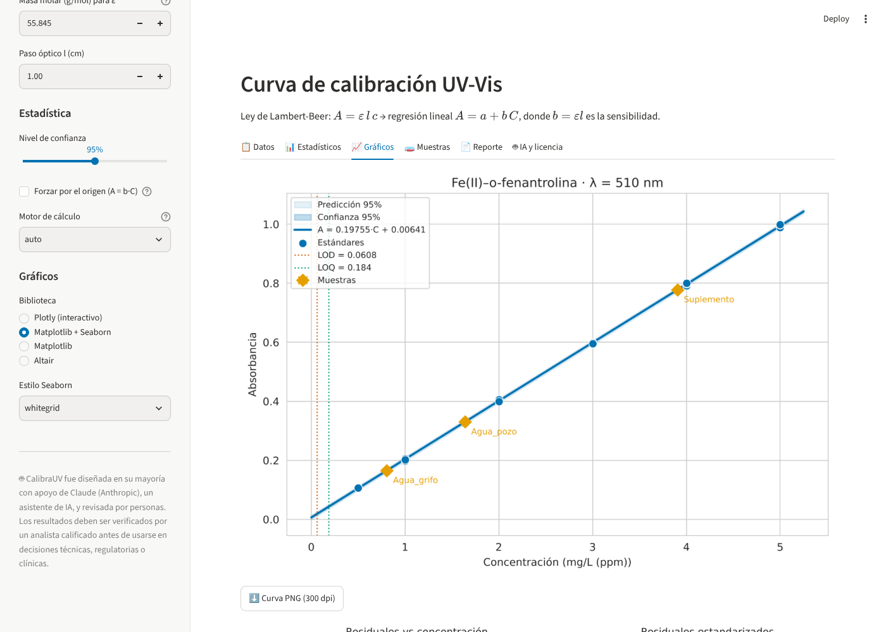

# 🧪 CalibraUV

**Curvas de calibración para espectroscopía UV-Vis basadas en la ley de Lambert-Beer**,
con estadística completa calculada en **R** y gráficos con **Matplotlib, Seaborn, Plotly y Altair**.

[](../../actions/workflows/pruebas.yml)


-d97757)

> 🤖 **Aviso de IA:** esta aplicación fue diseñada y programada **en su mayoría con el
> apoyo de Claude** (Anthropic) y revisada por personas. Lea la
> [Política de uso responsable de la IA](POLITICA_USO_RESPONSABLE_IA.md).



---

## ¿Qué hace?

| Área | Contenido |
|---|---|
| **Regresión** | A = a + b·C por mínimos cuadrados (`stats::lm` de R), opción de forzar por el origen |
| **Coeficientes** | Estimados, errores estándar, t, p e intervalos de confianza (90/95/99 %) |
| **Ajuste** | r, R², R² ajustado, s(y/x), ANOVA de la regresión, DER de la pendiente |
| **Supuestos** | Shapiro-Wilk, Breusch-Pagan, Durbin-Watson, falta de ajuste (con réplicas), residuales estandarizados, apalancamiento, distancia de Cook |
| **Analítica** | LOD y LOQ (ICH Q2), absortividad a = b/l y **absortividad molar ε** (también desde mg/L con la masa molar) |
| **Muestras** | Concentración por regresión inversa con su incertidumbre s(C₀) e intervalo de confianza; avisos de extrapolación, < LOD y < LOQ |
| **Gráficos** | Curva con bandas de confianza y predicción, LOD/LOQ, muestras; panel de diagnóstico (residuales, Q-Q, Cook) |
| **Bibliotecas** | Plotly (interactivo), Matplotlib + Seaborn, Matplotlib puro, Altair — PNG a 300 dpi para publicaciones |
| **Exportación** | Reporte HTML con interpretación, resultados JSON y residuales CSV |
| **Entrada** | Tabla editable, CSV (coma o punto y coma con coma decimal) y Excel |

Todas las fórmulas están explicadas en [docs/TEORIA.md](docs/TEORIA.md).

## Arquitectura

```
Interfaz (Streamlit, Python)
   │  datos CSV ──►  Rscript r/calibracion.R  ──► JSON  (motor de referencia: R base + stats)
   │             └►  calibrauv/motor_python.py         (respaldo y verificación: NumPy/SciPy)
   └─ gráficos:  Matplotlib · Seaborn · Plotly · Altair
```

- El script de R **no necesita paquetes adicionales** (solo R base), así que funciona
  igual en Windows y Linux.
- Si R no está instalado, la app usa automáticamente el motor Python.
- Las pruebas automáticas verifican que **R y Python den los mismos resultados**
  (tolerancia relativa 10⁻⁶) en Ubuntu y Windows.

## Instalación

Requisitos: **Python 3.10+** y (recomendado) **R 4.x**.

### 🐧 Ubuntu / Linux Mint

```bash
sudo apt update && sudo apt install -y python3 python3-venv python3-pip r-base git
```

```bash
git clone https://github.com/<su-usuario>/calibrauv.git
```

```bash
cd calibrauv && ./scripts/instalar_linux.sh
```

```bash
./scripts/ejecutar_linux.sh
```

### 🪟 Windows 10 / 11

1. Instale Python y R (en PowerShell o desde sus páginas oficiales:
   [python.org](https://www.python.org/downloads/) marcando *Add python.exe to PATH*,
   y [CRAN](https://cran.r-project.org/bin/windows/base/)):

   ```bash
   winget install Python.Python.3.12
   ```

   ```bash
   winget install RProject.R
   ```

2. Descargue el proyecto (botón **Code → Download ZIP** o `git clone`).
3. Doble clic en `scripts\instalar_windows.bat` (solo la primera vez).
4. Doble clic en `scripts\ejecutar_windows.bat`. Se abrirá el navegador en `http://localhost:8501`.

CalibraUV busca R automáticamente en `C:\Program Files\R\R-*`. Si lo instaló en otra
carpeta, defina la variable de entorno `CALIBRAUV_RSCRIPT` con la ruta completa a `Rscript.exe`.

### Instalación manual (cualquier sistema)

```bash
python -m venv .venv
```

```bash
.venv/bin/pip install -r requirements.txt        # Windows: .venv\Scripts\pip ...
```

```bash
.venv/bin/streamlit run app.py                   # Windows: .venv\Scripts\streamlit ...
```

## Uso

1. **Datos:** escriba o pegue sus estándares (concentración, absorbancia), o cargue un
   CSV/Excel. Las réplicas se ingresan como filas repetidas con la misma concentración.
2. **Muestras (opcional):** columnas `muestra` y `absorbancia`; una fila por réplica.
3. Configure en la barra lateral la unidad, el paso óptico, la masa molar, el nivel de
   confianza y la biblioteca de gráficos.
4. Revise **Estadísticos** → **Gráficos** → **Muestras** y descargue el **Reporte**.

Hay datos de ejemplo en [`datos/`](datos/) (Fe(II)–o-fenantrolina a 510 nm, por triplicado).

### Uso del motor de R sin interfaz

El script de R se puede usar solo, por ejemplo desde RStudio o la terminal:

```bash
Rscript r/calibracion.R --data=datos/ejemplo_calibracion_hierro.csv --unknowns=datos/ejemplo_muestras.csv --conf=0.95 --out=resultados.json
```

## Pruebas

```bash
pip install -r requirements-dev.txt && python -m pytest -v
```

## Estructura

```
calibrauv/
├── app.py                        Interfaz Streamlit
├── r/calibracion.R               Motor estadístico en R (referencia)
├── calibrauv/
│   ├── motor.py                  Selección de motor y absortividad molar
│   ├── motor_r.py                Puente Python → Rscript (Windows/Linux)
│   ├── motor_python.py           Motor de verificación NumPy/SciPy
│   ├── interpretacion.py         Interpretación de supuestos en lenguaje claro
│   ├── graficos.py               Matplotlib, Seaborn, Plotly, Altair
│   └── reporte.py                Tablas y reporte HTML
├── datos/                        Datos de ejemplo
├── docs/TEORIA.md                Fórmulas y referencias
├── scripts/                      Instaladores para Windows y Linux
├── tests/                        Pruebas (R vs Python)
└── POLITICA_USO_RESPONSABLE_IA.md
```

## Contribuir

¡Las contribuciones son bienvenidas! Lea [CONTRIBUTING.md](CONTRIBUTING.md) y la
[política de IA](POLITICA_USO_RESPONSABLE_IA.md).

## Licencia y créditos

Software libre bajo **licencia MIT** ([LICENSE](LICENSE)).

Construido sobre: [R](https://www.r-project.org/), [Streamlit](https://streamlit.io/),
[NumPy](https://numpy.org/), [SciPy](https://scipy.org/), [pandas](https://pandas.pydata.org/),
[Matplotlib](https://matplotlib.org/), [Seaborn](https://seaborn.pydata.org/),
[Plotly](https://plotly.com/python/) y [Altair](https://altair-viz.github.io/).

Diseñada en su mayoría con el apoyo de **Claude** (Anthropic).

> ⚠️ CalibraUV es una herramienta de apoyo educativo y de laboratorio. No es un software
> validado para uso regulatorio; verifique los resultados críticos según su sistema de calidad.
