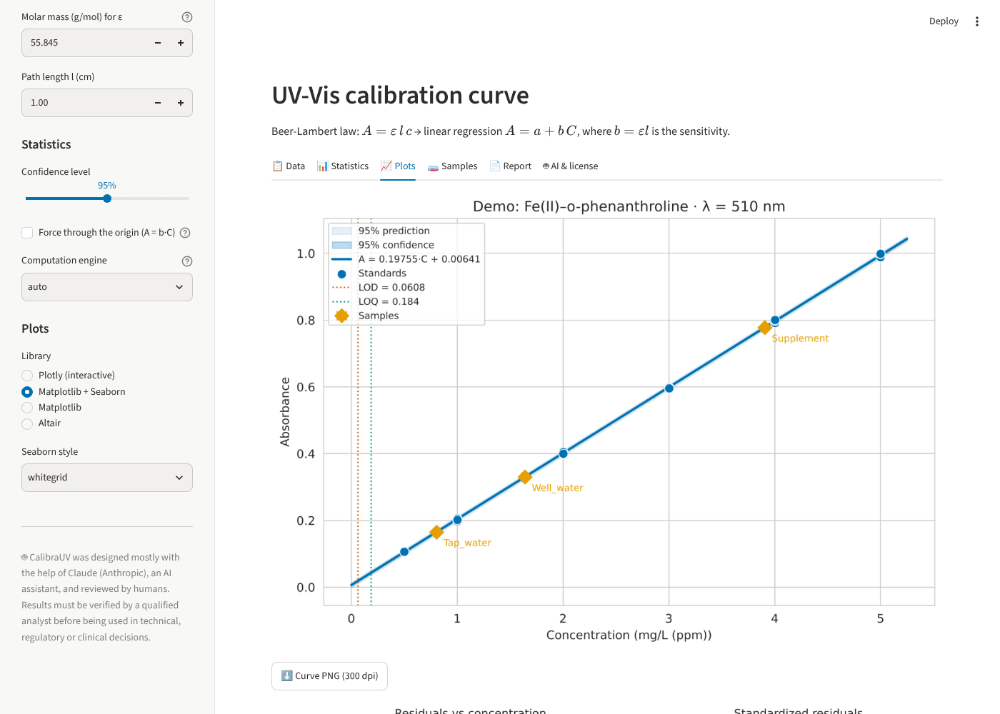

# 🧪 CalibraUV

**Calibration curves for UV-Vis spectroscopy based on the Beer-Lambert law**, for
**any analyte** that follows the law (metals, dyes, drugs, ethanol by colorimetric
methods, proteins, etc.), with full statistics computed in **R** and plots made with **Matplotlib, Seaborn, Plotly and Altair**.

[](../../actions/workflows/tests.yml)


-d97757)

> 🤖 **AI notice:** this application was designed and programmed **mostly with the
> help of Claude** (Anthropic) and reviewed by humans. Please read the
> [Responsible AI Use Policy](RESPONSIBLE_AI_POLICY.md).
>
> Independent project, not affiliated with or endorsed by Anthropic. Claude is a
> trademark of Anthropic.



---

## What does it do?

| Area | Contents |
|---|---|
| **Regression** | A = a + b·C by least squares (R's `stats::lm`), optionally forced through the origin |
| **Coefficients** | Estimates, standard errors, t, p and confidence intervals (90/95/99 %) |
| **Fit** | r, R², adjusted R², s(y/x), regression ANOVA, slope RSD |
| **Assumptions** | Shapiro-Wilk, Breusch-Pagan, Durbin-Watson, lack of fit (with replicates), standardized residuals, leverage, Cook's distance |
| **Analytical** | LOD and LOQ (ICH Q2), absorptivity a = b/l and **molar absorptivity ε** (also from mg/L using the molar mass) |
| **Samples** | Concentration by inverse regression with its uncertainty s(C₀) and confidence interval; warnings for extrapolation, < LOD and < LOQ |
| **Figures for publication** | Exact journal sizes (85 / 114 / 174 mm or custom), vector **PDF, SVG, EPS** or **TIFF (LZW) / PNG up to 1200 dpi**, RGB or CMYK, Arial/Times embedded as TrueType (no Type 3), editable SVG text, no transparency, panel letters (a)–(d); the preview is exactly what is exported |
| **Figure design** | One design panel for Matplotlib, Seaborn, Plotly and Altair: themes (journal, Seaborn, classic, dark), colour-blind palettes (Okabe-Ito, viridis, cividis…) or grayscale, custom colours, markers, sizes, line widths, grid, minor ticks, legend position, axis labels, equation box, mean ± SD of replicates, residual lines |
| **Plots** | Curve with confidence and prediction bands, LOD/LOQ and samples; diagnostics panel (residuals, Q-Q, Cook) |
| **Libraries** | Plotly (interactive), Matplotlib + Seaborn, plain Matplotlib, Altair — 300 dpi PNG for publications |
| **Export** | HTML report with interpretation, JSON results and residuals CSV |
| **Step-by-step calculation** | For each sample, every formula written out with its own numbers (blank correction, mean, C₀ = (Ā₀ − a)/b, uncertainty, confidence interval, content), as if done by hand, and checked against the R engine |
| **Concepts** | Built-in glossary: what each quantity means (absorbance, slope, R², s(y/x), residuals, LOD/LOQ, p-values, confidence bands, equivalents, recovery…) and how to interpret it |
| **Your data is kept** | Tables and settings survive switching language, method, variant or tab during the session |
| **Interface language** | English or **Spanish** (selector at the top of the sidebar; the choice is remembered) |
| **Laboratory protocols** | Total phenolics (Folin-Ciocalteu/NaOH, 760 nm), flavonoids (NaNO₂–AlCl₃–NaOH, 500 nm) and tannins by casein precipitation (TP − RP), with their calibration levels and procedure ([docs/METHODS.md](docs/METHODS.md)) |
| **Method presets** | Folin-Ciocalteu (total phenolics), AlCl₃ (flavonoids), vanillin-HCl (condensed tannins), bromocresol green (alkaloids), vanillin-H₂SO₄ (saponins), pH differential (anthocyanins, AOAC 2005.02) — each with its variants, standards, warnings and references ([docs/METHODS.md](docs/METHODS.md)) |
| **Blank correction** | Reagent blank and per-sample blank (coloured extracts) |
| **Content** | Content = C · DF / C_extract (extract dissolved at a known concentration, e.g. 50 µg/mL) or C · V · DF / m, per replicate, mean ± SD and RSD%, in mg/g or µg/g (e.g. mg GAE/g extract) |
| **LOD/LOQ basis** | σ = s(y/x), SD of the intercept, or SD of ≥ 10 blanks (ICH Q2) |
| **Curve acceptance** | Rejected if R² < threshold (default 0.99) or significant lack of fit; design check (≥ 5 levels × 3 replicates) |
| **Standard addition** | x-intercept with uncertainty and confidence interval; slope parallelism vs external curve (< 3%) |
| **Validation (ICH Q2)** | Checklist, repeatability / intermediate precision (RSD ≤ 2% or 5%), recovery (80–120% or 98–102%) |
| **Input** | Editable tables, CSV (comma, or semicolon with decimal comma) and Excel |

All formulas are explained in [docs/THEORY.md](docs/THEORY.md); the method presets,
their sources and how to add new ones are in [docs/METHODS.md](docs/METHODS.md).

> Values in the presets are labelled as **literature** (from the cited references) or
> **general analytical practice** (to be verified against your laboratory protocol).

## Architecture

```
Interface (Streamlit, Python)
   │  CSV data ──►  Rscript r/calibration.R  ──► JSON   (reference engine: base R + stats)
   │            └►  calibrauv/engine_python.py          (fallback & cross-check: NumPy/SciPy)
   └─ plots:  Matplotlib · Seaborn · Plotly · Altair
```

- The R script **needs no extra packages** (base R only), so it works the same on
  Windows and Linux.
- If R is not installed, the app automatically uses the Python engine.
- The automated tests check that **R and Python give the same results**
  (relative tolerance 10⁻⁶) on Ubuntu and Windows.

## Installation

Requirements: **Python 3.10+** and (recommended) **R 4.x**.

### 🐧 Ubuntu / Linux Mint

```bash
sudo apt update && sudo apt install -y python3 python3-venv python3-pip r-base git
```

```bash
git clone https://github.com/Eleos-pax/Lambert-Beer-Content-Calculator.git
```

```bash
cd Lambert-Beer-Content-Calculator && ./scripts/install_linux.sh
```

```bash
./scripts/run_linux.sh
```

### 🪟 Windows 10 / 11

1. Install Python and R (from PowerShell, or from their official sites:
   [python.org](https://www.python.org/downloads/) ticking *Add python.exe to PATH*,
   and [CRAN](https://cran.r-project.org/bin/windows/base/)):

   ```bash
   winget install Python.Python.3.12
   ```

   ```bash
   winget install RProject.R
   ```

2. Download the project (**Code → Download ZIP** button, or `git clone`).
3. Double-click `scripts\install_windows.bat` (first time only).
4. Double-click `scripts\run_windows.bat`. Your browser will open at `http://localhost:8501`.

CalibraUV finds R automatically in `C:\Program Files\R\R-*`. If you installed it
somewhere else, set the `CALIBRAUV_RSCRIPT` environment variable to the full path
of `Rscript.exe`.

### Updating and uninstalling

| | Windows (double-click) | Linux |
|---|---|---|
| **Update** to the latest version of this repository | `scripts\update_windows.bat` | `./scripts/update_linux.sh` |
| **Uninstall** (removes the virtual environment, caches and settings; optionally the whole folder) | `scripts\uninstall_windows.bat` | `./scripts/uninstall_linux.sh` |

The update works both for `git clone` installations (`git pull`) and for ZIP
downloads (it downloads the latest ZIP and copies it over, keeping the virtual
environment and your settings). The uninstaller asks before deleting anything and
never removes R or Python.

### Manual installation (any system)

```bash
python -m venv .venv
```

```bash
.venv/bin/pip install -r requirements.txt        # Windows: .venv\Scripts\pip ...
```

```bash
.venv/bin/streamlit run app.py                   # Windows: .venv\Scripts\streamlit ...
```

## Usage

0. **Language:** choose English or Español at the top of the sidebar.
1. **Method:** choose a preset (or *Generic*) in the sidebar, with its variant and standard.
2. **Data:** type or paste your standards (concentration, absorbance), or upload a
   CSV/Excel file. Enter replicates as repeated rows with the same concentration.
3. **Samples (optional):** columns `sample` and `absorbance` (one row per replicate), and
   optionally `sample_blank`, `extract_conc_ug_mL` (or `extract_volume_mL` + `mass_g`)
   and `dilution_factor` to obtain the content per gram. For tannins by difference,
   the columns are `A_TP` and `A_RP`.
4. In the sidebar, set the unit, path length, molar mass, confidence level and
   plotting library.
5. Check **Statistics** → **Plots** → **Samples**, follow any sample in **Step-by-step
   calculation**, look up terms in **Concepts**, and download the **Report**.

The app is **not tied to any specific method**: enter the analyte, wavelength, units
and molar mass of your own assay. Synthetic demo data is included in [`data/`](data/)
(generic: Fe(II)–o-phenanthroline at 510 nm; Folin-Ciocalteu with gallic acid, including
samples, standard addition and validation; pH differential) only to show how the app works — untick **Load demo data** in the sidebar to start with an empty table.

### Using the R engine without the interface

The R script can be used on its own, for example from RStudio or the terminal:

```bash
Rscript r/calibration.R --data=data/example_iron_calibration.csv --unknowns=data/example_samples.csv --conf=0.95 --out=results.json
```

## Figures for publication

Choose **Matplotlib** or **Matplotlib + Seaborn** in the sidebar, then in the *Plots* tab:

1. **🎨 Design** — theme, palette, font (Arial/Helvetica or Times) and size in points
   *at final size*, markers, lines, grid, legend, axis labels and the elements to show.
2. **📐 Size and export for publication** — width (single, 1.5 or double column, or
   custom) and height in mm, format and resolution, then **Prepare publication files**.

| Format | Type | Use |
|---|---|---|
| PDF | vector | recommended for graphs; fonts embedded as TrueType |
| SVG | vector | editable text (Inkscape, Illustrator) |
| EPS | vector | journals that still require EPS |
| TIFF | raster, LZW lossless | 600 dpi (combination) or 1200 dpi (line art); RGB or CMYK |
| PNG | raster, lossless | presentations, web |

The exported file has exactly the chosen size (e.g. 85.0 × 65.0 mm), fonts are 6–12 pt at
that size, and raster files carry their dpi and have no alpha channel. Always check your
journal's author guidelines. With Plotly, the camera icon downloads a vector SVG.

## Tests

```bash
pip install -r requirements-dev.txt && python -m pytest -v
```

## Project structure

```
Lambert-Beer-Content-Calculator/
├── app.py                        Streamlit interface
├── r/calibration.R               Statistical engine in R (reference)
├── calibrauv/
│   ├── engine.py                 Engine selection and molar absorptivity
│   ├── engine_r.py               Python → Rscript bridge (Windows/Linux)
│   ├── engine_python.py          NumPy/SciPy verification engine
│   ├── interpretation.py         Plain-language interpretation of assumptions
│   ├── methods.json / methods.py Method presets with references
│   ├── analysis.py               Blank, content, tannins by difference, LOD basis, standard addition, validation
│   ├── handcalc.py               Step-by-step ("by hand") calculation of each sample
│   ├── concepts.py               Glossary / how to interpret (English and Spanish)
│   ├── i18n.py / lang_es.py      Interface language (English / Spanish)
│   ├── ph_differential.py        Anthocyanins by pH differential (no curve)
│   ├── plots.py                  Matplotlib, Seaborn, Plotly, Altair
│   └── report.py                 Tables and HTML report
├── data/                         Example data
├── docs/THEORY.md                Formulas and references
├── docs/METHODS.md               Method presets and their sources
├── scripts/                      Install, run, update and uninstall (Windows and Linux)
├── tests/                        Tests (R vs Python)
└── RESPONSIBLE_AI_POLICY.md
```

## Contributing

Contributions are welcome! Please read [CONTRIBUTING.md](CONTRIBUTING.md) and the
[AI policy](RESPONSIBLE_AI_POLICY.md).

## License and credits

Free software under the **MIT license** ([LICENSE](LICENSE)).

Built on: [R](https://www.r-project.org/), [Streamlit](https://streamlit.io/),
[NumPy](https://numpy.org/), [SciPy](https://scipy.org/), [pandas](https://pandas.pydata.org/),
[Matplotlib](https://matplotlib.org/), [Seaborn](https://seaborn.pydata.org/),
[Plotly](https://plotly.com/python/) and [Altair](https://altair-viz.github.io/).

Designed mostly with the help of **Claude** (Anthropic).

> ⚠️ CalibraUV is an educational and laboratory support tool. It is not validated
> software for regulatory use; verify critical results according to your quality system.
